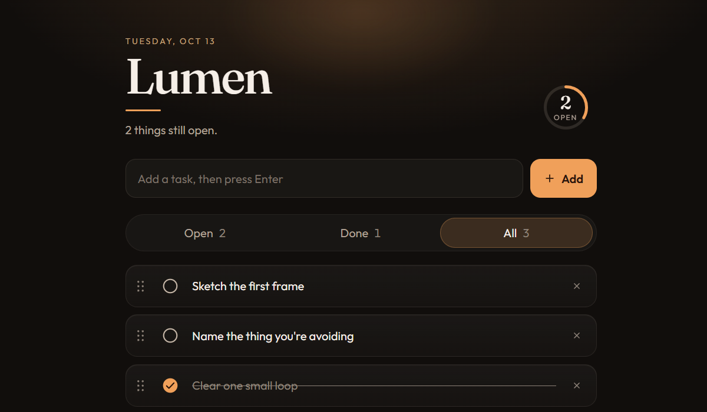

<p align="center">
  
</p>

<h1 align="center">Lumen</h1>

<p align="center">
  A to-do list with a drawn check, a progress ring, and motion that stays under a fifth of a second.
</p>

## Open it

No install and no build. Open `index.html` in a browser.

Or serve the folder:

```bash
python -m http.server 5173
```

Then go to [http://127.0.0.1:5173](http://127.0.0.1:5173).

## Use it

| Do this | With |
| --- | --- |
| Add a task | Type it and press Enter |
| Mark it done | The circle. The tick draws, the title strikes through, and the ring advances |
| Edit the title | Click the words. Enter saves, Escape cancels |
| Reorder | Drag the grip, or focus a task and use Alt + the arrow keys |
| See one slice | Open, Done, or All. The pill slides to the one you pick |
| Remove finished work | Clear completed |

The list is saved in this browser. Clearing the site’s data clears the tasks.

## Motion

Checks, the filter pill, and reordering run at about 180 milliseconds, long enough to see and short enough that the click still feels instant.

If the system asks for reduced motion, the slides and sparks stop. The check still appears, and the list still updates.

## Files

`index.html` is the page, `styles.css` is the light and the motion, and `app.js` is the list.
